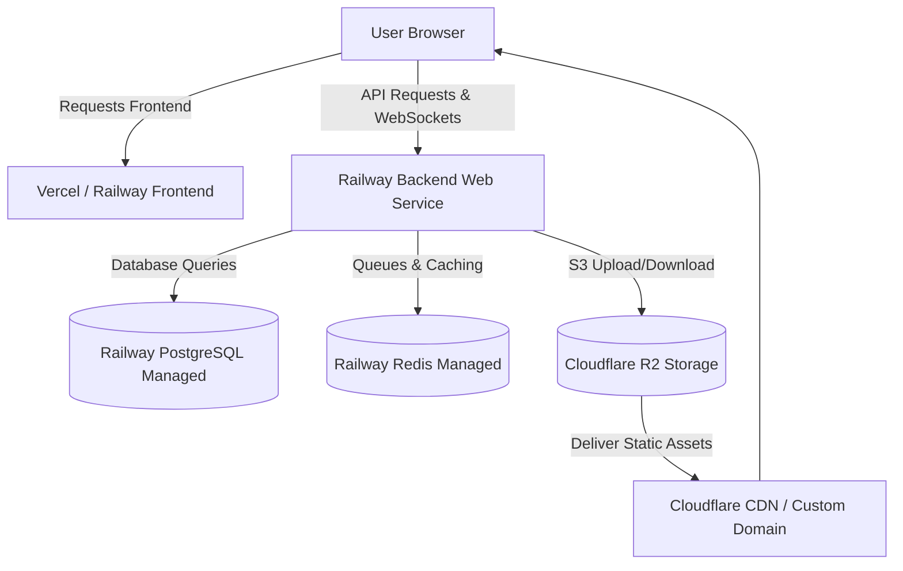

# Basaeer: Comprehensive Production Deployment & Dockerization Guide

This guide provides a step-by-step, bulletproof walkthrough for deploying the **Basaeer** application to production using **Railway** (for the backend NestJS service, Redis queue, and PostgreSQL database) and **Cloudflare R2** (for secure, high-performance object storage with zero egress fees).

---

## 1. System Architecture Overview

Basaeer is structured as a modern full-stack web application. For production, we separate the static/frontend tier from the dynamic/stateful backend tier to maximize performance, security, and cost-efficiency:



*   **Frontend**: Next.js (TailwindCSS / TypeScript), deployed on **Vercel** (recommended for speed and Edge CDN) or **Railway** (as a Docker container).
*   **Backend**: NestJS REST API and WebSocket Server, deployed on **Railway** as a Docker service.
*   **Database**: PostgreSQL, managed by **Railway**.
*   **Cache & Queue**: Redis, managed by **Railway** (used by BullMQ for background tasks and Socket.io adapters).
*   **Storage**: **Cloudflare R2**, an S3-compatible object storage for certificates, proofs of payment, and user uploads.

---

## 2. What You Need to Provide (Prerequisites Checklist)

Before beginning the deployment, ensure you have set up the following accounts and gathered the necessary information:

- [ ] **GitHub Account**: Your codebase must be pushed to a private or public GitHub repository.
- [ ] **Railway Account**: Create an account at [railway.app](https://railway.app). A paid tier (Hobby or Pro) is recommended to prevent services from sleeping.
- [ ] **Cloudflare Account**: Create an account at [cloudflare.com](https://cloudflare.com) and enable **R2** (requires adding a payment method, though the first 10GB/month are completely free).
- [ ] **Domain Name** (Optional but highly recommended): A custom domain configured on Cloudflare (e.g., `basaeer.com`) to set up clean custom subdomains for your API (`api.basaeer.com`) and file storage (`cdn.basaeer.com`).
- [ ] **Vercel Account** (Optional): Create an account at [vercel.com](https://vercel.com) if you decide to host the frontend on Vercel's global CDN.

---

## 3. How Many Projects to Create on Railway?

> [!IMPORTANT]
> You only need to create **exactly ONE (1) Project** on Railway.
>
> In Railway, a **Project** is a logical container that groups multiple **Services** together. By keeping all services in the same project, they can communicate with each other securely over Railway's **Private Internal Network** (zero latency, zero egress cost, and completely hidden from the public internet).

Within your single Railway project, you will deploy **three (or four) Services**:
1.  **PostgreSQL** (Managed Database Service)
2.  **Redis** (Managed Key-Value Store Service)
3.  **Backend API** (Docker-based Web Service)
4.  *(Optional)* **Frontend** (Docker-based Web Service - if not using Vercel)

---

## 4. Phase 1: Cloudflare R2 Setup (Object Storage)

Cloudflare R2 handles secure storage for certificates, profile photos, and document uploads.

### Step 1.1: Create your Bucket
1. Log in to the **Cloudflare Dashboard**.
2. Click **R2** in the left sidebar navigation.
3. Click **Create Bucket**.
4. Set the bucket name to `basaeer-production` (or your preferred name).
5. Choose **Automatic** for location or select your closest region, then click **Create Bucket**.

### Step 1.2: Generate R2 API Keys
1. From the main R2 page, look at the right sidebar and click **Manage R2 API Tokens**.
2. Click **Create API Token**.
3. Name your token (e.g., `Basaeer Production Token`).
4. Set Permissions to **Object Read & Write**.
5. Set the scope to **Specific buckets** and select your `basaeer-production` bucket.
6. Click **Create API Token**.
7. **CRITICAL**: Copy the following credentials immediately and save them in a secure place. They will never be shown again:
   *   **Access Key ID** (Corresponds to `R2_ACCESS_KEY_ID`)
   *   **Secret Access Key** (Corresponds to `R2_SECRET_ACCESS_KEY`)
   *   **Account ID** (Found on the API Tokens page or R2 Overview; corresponds to `R2_ACCOUNT_ID`)

### Step 1.3: Configure CORS Policy
To allow the backend and frontend to fetch and upload assets securely from browsers, you must configure a CORS policy:
1. Go to your bucket `basaeer-production` -> **Settings** tab.
2. Scroll down to the **CORS Policy** section and click **Add CORS Policy**.
3. Paste the following JSON configuration (adjust the domains to match your frontend production and local dev URLs):
```json
[
  {
    "AllowedOrigins": [
      "https://basaeer-frontend.vercel.app",
      "https://your-custom-domain.com",
      "http://localhost:3000"
    ],
    "AllowedMethods": ["GET", "PUT", "POST", "DELETE", "HEAD"],
    "AllowedHeaders": ["*"],
    "ExposeHeaders": ["ETag"],
    "MaxAgeSeconds": 3000
  }
]
```
4. Click **Save**.

### Step 1.4: Set up Public Access (Custom Domain)
1. In your bucket settings, scroll to the **Public Access** section.
2. Click **Connect Domain**.
3. Enter your custom subdomain (e.g., `cdn.basaeer.com`). Cloudflare will automatically handle DNS routing and provision an SSL certificate.
4. Save this subdomain URL. It will be used as `R2_PUBLIC_DOMAIN` (e.g., `https://cdn.basaeer.com`).

---

## 5. Phase 2: Railway Project & Database Provisioning

### Step 2.1: Initialize the Project
1. Log in to your [Railway Dashboard](https://railway.app).
2. Click **New Project** in the upper right.
3. Select **Provision PostgreSQL** from the dropdown list. Railway will immediately spin up a managed PostgreSQL database.

### Step 2.2: Provision Redis
1. Once your project board loads, click **New** (the `+` button) in the top-right or center.
2. Select **Database** -> **Add Redis**. Railway will provision a fully managed Redis instance in the same network.

---

## 6. Phase 3: Dockerizing & Deploying the Backend on Railway

The backend utilizes `Dockerfile.railway` and `railway.json` located at the root of the project. These files build the application as a multi-stage Docker container and automate database migrations on every deploy.

### Step 3.1: Connect Your GitHub Repository
1. In your Railway project board, click **New** -> **GitHub Repo**.
2. If you haven't linked GitHub yet, click **Configure GitHub App** and grant Railway access to your Basaeer repository.
3. Select your repository.
4. Do **not** deploy immediately. First, click on the newly created Backend service card and go to the **Settings** tab.

### Step 3.2: Configure the Service Build Settings
Railway will automatically detect your project structure, but let's make sure it knows to use our specialized configs:
1. In the **Settings** tab of your Backend service:
   *   Under **Build**, ensure **Builder** is set to **Docker**.
   *   Set the **DockerfilePath** to `Dockerfile.railway`.
   *   Set the **Watch Paths** to `/backend/**` and `/packages/**`.
2. Scroll to **Service Domain**:
   *   Click **Generate Domain** to get a public Railway domain (e.g., `basaeer-production.up.railway.app`), or link your own custom domain (e.g., `api.basaeer.com`).

### Step 3.3: Configure Backend Environment Variables
Go to the **Variables** tab of your Backend service and add the following keys. Railway supports referencing other services, which makes configuration extremely secure and dynamic!

| Environment Variable | Recommended Railway Value / Reference | Notes |
| :--- | :--- | :--- |
| **`NODE_ENV`** | `production` | Enables production optimizations in NestJS. |
| **`PORT`** | `3001` | The internal port exposed by `Dockerfile.railway`. |
| **`DATABASE_URL`** | `${{Postgres.DATABASE_URL}}` | **Railway Magic**: Automatically links your managed Postgres connection string. |
| **`REDIS_URL`** | `${{Redis.REDIS_URL}}` | Automatically links your managed Redis connection string. |
| **`REDIS_HOST`** | `${{Redis.REDIS_HOST}}` | Redis internal host. |
| **`REDIS_PORT`** | `${{Redis.REDIS_PORT}}` | Redis internal port. |
| **`REDIS_PASSWORD`** | `${{Redis.REDIS_PASSWORD}}` | Redis internal password. |
| **`JWT_SECRET`** | *[Generate secure 64-char hex key]* | Run `openssl rand -hex 64` in terminal to generate. |
| **`JWT_REFRESH_SECRET`** | *[Generate another secure hex key]* | Run `openssl rand -hex 64` in terminal to generate. |
| **`JWT_EXPIRES_IN`** | `7d` | Token expiration time. |
| **`JWT_REFRESH_EXPIRES_IN`**| `30d` | Refresh token expiration time. |
| **`ENCRYPTION_SALT`** | *[Generate secure random salt]* | Used for internal data encryption. |
| **`ENCRYPTION_SECRET`** | *[Generate secure 32-char secret]* | Used for internal data encryption. |
| **`R2_ACCOUNT_ID`** | *[Your Cloudflare Account ID]* | From Phase 1.2. |
| **`R2_ACCESS_KEY_ID`** | *[Your R2 Access Key ID]* | From Phase 1.2. |
| **`R2_SECRET_ACCESS_KEY`** | *[Your R2 Secret Access Key]* | From Phase 1.2. |
| **`R2_BUCKET_NAME`** | `basaeer-production` | Or whatever you named your bucket in Phase 1.1. |
| **`R2_PUBLIC_DOMAIN`** | `https://cdn.basaeer.com` | From Phase 1.4. |
| **`CORS_ALLOWED_ORIGINS`**| `https://your-frontend.vercel.app` | Comma-separated list of allowed frontend domains. |
| **`API_URL`** | `https://your-api.up.railway.app` | The public URL generated for your Backend service. |
| **`FRONTEND_URL`** | `https://your-frontend.vercel.app` | The public URL where your frontend is deployed. |
| **`DEFAULT_ADMIN_EMAIL`**| `admin@basaeer.com` | Initial super admin account created on seed. |
| **`DEFAULT_ADMIN_PASSWORD`**| *[Set a strong secure password]* | Initial super admin password. |

### Step 3.4: Deploy the Backend
1. Once variables are saved, Railway will automatically trigger a build.
2. It will use `Dockerfile.railway` to build the NestJS backend and shared-types.
3. According to `railway.json`, Railway will execute:
   ```bash
   npx prisma migrate deploy --schema=backend/prisma/schema.prisma && node backend/dist/main.js
   ```
   This ensures that all your production PostgreSQL tables are created/migrated **before** the NestJS server starts, preventing any database-related boot failures!

---

## 7. Phase 4: Deploying the Frontend (Two Best Options)

You have two excellent choices for hosting your Next.js Frontend.

### Option A: Host on Vercel (Recommended - Free Tier Friendly)
Vercel is the creator of Next.js and provides serverless edge networks that deliver outstanding speeds globally.

1. Go to [Vercel](https://vercel.com) and click **Add New** -> **Project**.
2. Import your Basaeer GitHub repository.
3. Under **Configure Project**:
   *   **Framework Preset**: Next.js (Auto-detected).
   *   **Root Directory**: Set to `frontend` (Click edit and select the `frontend` folder).
4. Expand the **Environment Variables** section and add:
   *   `NEXT_PUBLIC_API_URL` = `https://your-api.up.railway.app` (Your public Railway Backend URL).
5. Click **Deploy**. Vercel will build and host your Next.js application.

---

### Option B: Host on Railway as a Docker Service (All-in-One Railway Project)
If you prefer to keep your entire stack in one place on Railway, you can deploy the frontend as another Docker service.

1. In your Railway project dashboard, click **New** -> **GitHub Repo**.
2. Select your repository again. This will create a second web service card.
3. Rename this card to `Basaeer Frontend`.
4. Go to the **Settings** tab of the Frontend service card:
   *   Under **Build**, set **DockerfilePath** to `frontend/Dockerfile`.
   *   Under **Watch Paths**, set it to `/frontend/**`.
5. Go to the **Variables** tab and add:
   *   `NEXT_PUBLIC_API_URL` = `https://your-api.up.railway.app` (The Backend Service's public domain).
   *   `PORT` = `3000`.
6. Scroll down in **Settings** and click **Generate Domain** to get a public URL for your frontend.
7. Copy this generated frontend URL, go back to your **Backend Service Variables**, and update:
   *   `FRONTEND_URL` = `https://your-frontend.up.railway.app`
   *   `CORS_ALLOWED_ORIGINS` = `https://your-frontend.up.railway.app`
8. Redeploy the Backend to apply the updated CORS settings.

---

## 8. Phase 5: Post-Deployment Verification Checklist

Verify your production system is fully operational by completing this checklist:

1.  **Check Deploy Logs on Railway (Backend)**:
    *   Ensure there are no errors connecting to PostgreSQL or Redis.
    *   Confirm you see `Cloudflare R2 S3 Client initialized` in the logs.
    *   Confirm the server is successfully listening on port `3001` and passing health checks.
2.  **Verify DB Migrations**:
    *   Connect to your database using the **Data** tab on your Railway PostgreSQL service card to verify that all tables are populated.
3.  **Test CORS and API connection**:
    *   Open your deployed frontend URL in a browser.
    *   Open the browser Developer Console (`F12` -> Network tab).
    *   Trigger a login or fetch request and ensure no CORS blockages occur.
    *   Ensure WebSocket connections (if used) connect seamlessly.
4.  **Test File Uploads (Cloudflare R2)**:
    *   Try uploading an attachment (like an admission document or profile picture).
    *   Check your Cloudflare R2 dashboard -> `basaeer-production` bucket to ensure the file was uploaded, has the correct MIME type, and displays with your custom domain.

---

## 9. Troubleshooting Common Production Failures

### ❌ Prisma Client Initialization Error
*   **Symptom**: `PrismaClientInitializationError: Can't reach database server...` or crashing on migrations.
*   **Fix**: Verify your `DATABASE_URL` is set to `${{Postgres.DATABASE_URL}}` in your Backend service variables. Do not hardcode credentials. Ensure the PostgreSQL service is active and fully healthy in Railway.

### ❌ Cloudflare R2 SignatureDoesNotMatch or Access Denied
*   **Symptom**: Uploads fail with a `500` error, and logs show S3 Signature mismatch.
*   **Fix**: Double-check your `R2_ACCESS_KEY_ID` and `R2_SECRET_ACCESS_KEY`. Ensure the API token you generated in Cloudflare has both **Read & Write** permissions and is authorized for your specific bucket.

### ❌ CORS Errors on Deployed Frontend
*   **Symptom**: The frontend console shows `Access to fetch at 'api.basaeer.com' from origin 'frontend.vercel.app' has been blocked by CORS policy`.
*   **Fix**: Ensure `CORS_ALLOWED_ORIGINS` in your Backend service variables matches your exact frontend URL (including `https://`, with no trailing slash). If you have multiple domains, separate them with commas.

### ❌ Out of Memory (OOM) Crashes on Railway Backend
*   **Symptom**: Railway log displays `Exited with status code 137 (OOM)`.
*   **Fix**: Multi-stage Docker builds can occasionally consume significant RAM. If your build crashes during `npm run build`, go to Backend Service -> Settings, scroll to **Resources**, and temporarily increase memory limit to `1GB` or `2GB` during build time, then scale it back down for running the container.
